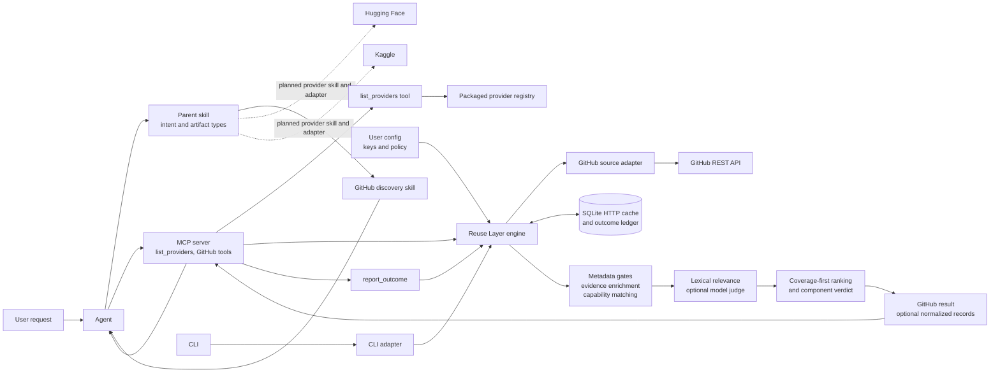
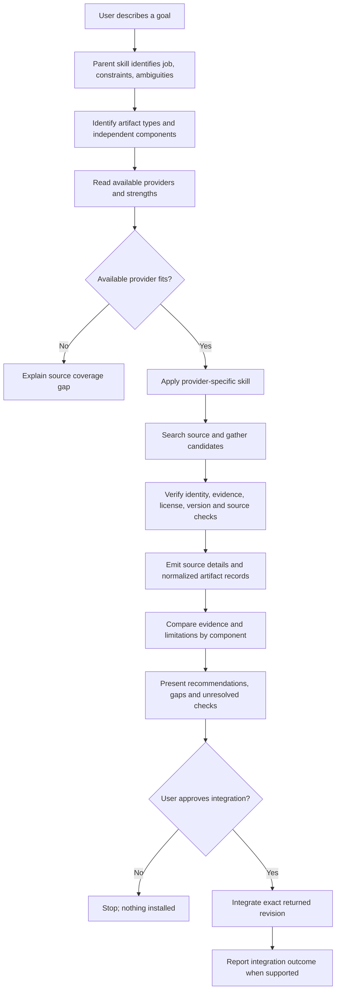

# Reuse Layer architecture

Reuse Layer helps an agent find and assess reusable open-source components before building them. The
architecture separates provider-neutral intent and routing from provider-specific discovery and checks.

## System view

GitHub is the only active discovery provider today. Hugging Face and Kaggle are catalog entries marked
`planned`; the dashed connections are an extension point, not working integrations. The registry is
packaged at `src/reuse_layer/integrations/providers.toml` and surfaced to the parent through
`list_providers`. It describes capabilities but does not execute searches.

## Request flow

Each component receives its own provider check and decision. Run checks sequentially to keep each request
focused and make timeout retries easier to interpret. A provider-specific result remains authoritative
for its own verdict and checks; normalized records provide shared fields for comparison, not a shared
score or an assertion that checks are equivalent.

## Shared normalized artifact record

Every provider adapter should expose this additive record alongside its provider-specific result. GitHub
includes it when `find_reusable` is called with `include_normalized=true`, keeping the default response
compact:

| Field | Meaning |
| --- | --- |
| `schema_version` | Version of the normalized record contract. |
| `provider_id`, `artifact_type` | Provider registry ID and artifact category. |
| `id`, `name`, `url` | Stable provider identity, label, and canonical location. |
| `version`, `revision` | Human-facing version and immutable revision, when available. |
| `license` | SPDX or provider-reported license; `null` when not established. |
| `evidence` | Capability matches, evidence locations, and checks actually completed. |
| `limitations` | Missing evidence, unresolved checks, and integration risks. |

Unknown values stay unknown; adapters must not fill gaps with guesses. Keep provider scores, verdicts,
licenses, and security findings in their original context because providers may use different
methodologies.
