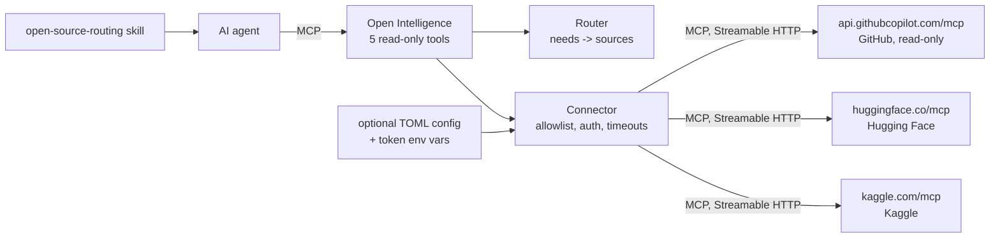
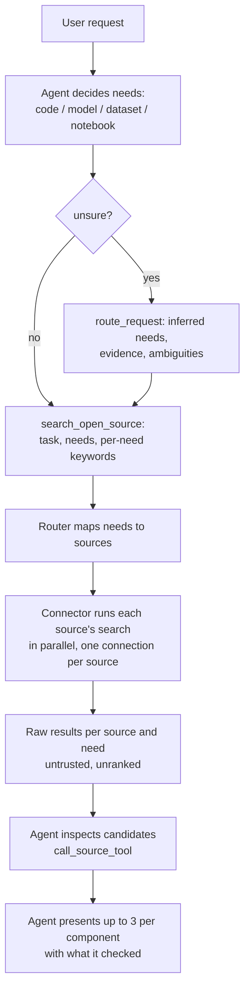

# Architecture

Open Intelligence is an MCP server that is also an MCP *client*. The agent talks to it; it talks to the
official GitHub, Hugging Face and Kaggle MCP servers.

## Request flow

## Modules

| module | role |
| --- | --- |
| `sources.py` | the three official servers: endpoint, auth env vars, read-only tool allowlist, how to search each need |
| `config.py` | optional TOML overrides (endpoint, transport, headers, token env names); refuses secrets in the file |
| `connector.py` | MCP client: connect (HTTP or stdio), list/call allowed tools, timeouts, clean errors, output cap |
| `router.py` | needs -> sources, with evidence, ambiguities and confidence |
| `server.py` | the MCP server: tools, instructions, the routing prompt |
| `cli.py` | `serve`, `route`, `sources`, `search`, `skill-path` |
| `skills/open-source-routing/SKILL.md` | the routing skill for agents that load skills |

## Design decisions

- **A gateway, not a pass-through.** The three upstream servers expose about 100 tools together (Kaggle
  alone 76, including upload, download and submit). Loading all of them makes agents pick wrong tools and
  costs context. The agent sees five tools; the upstream tools stay reachable through `call_source_tool`,
  limited to a read-only allowlist.
- **Route by artifact kind.** "Data" in a request does not mean a dataset is needed. The router asks what
  kind of artifact would let the user build on existing work (code, model, dataset, notebook) and maps that
  to the platforms where it lives.
- **The agent decides, the router checks.** The agent understands the request better than any word list.
  It passes `needs`; the router's inference is the fallback, and its disagreements come back as
  `ambiguities`.
- **Stateless connections.** One short MCP connection per source per request. A source that is down or
  missing a token affects only its own results, and the error says what to fix.
- **Tokens from the environment only.** Never in the config file, tool arguments, results or errors.
- **No ranking yet.** Results keep each platform's order and say so. Ranking is being researched:
  see [ranking-parameters.md](ranking-parameters.md).
