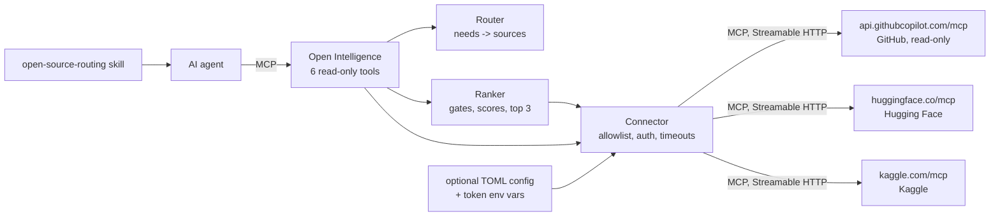
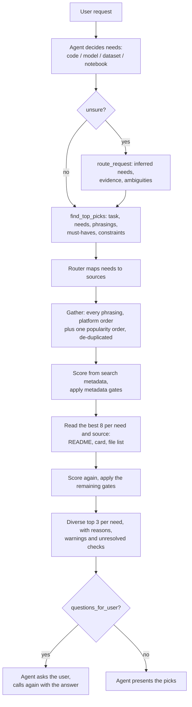

# Architecture

Open Intelligence is an MCP server that is also an MCP *client*. The agent talks to it; it talks to the
official GitHub, Hugging Face and Kaggle MCP servers.

## Request flow

`search_open_source` remains for exploring: it returns each platform's raw results, unranked.

## The ranking pipeline

| stage | what happens | code |
| --- | --- | --- |
| adapters | which upstream calls to make for a (source, need), and how to read their results into one `Candidate` shape | `ranking/adapters.py` |
| security evidence | OpenSSF Scorecard and known vulnerabilities for repositories, over plain HTTPS (`api.scorecard.dev`, `api.deps.dev`): the one place that does not go through an MCP server | `ranking/evidence.py` |
| gates | facts that disqualify: archived, a critical known vulnerability, license against the constraints, pickle-only weights, size, age, poor fit | `ranking/scoring.py` |
| scores | fit, quality, health, trust, adoption, each 0 to 1; unknown evidence is neutral and reported | `ranking/scoring.py` |
| copies | re-uploads of a dataset and conversions of a model fold under the original, which is the entry shown | `ranking/scoring.py` |
| selection | best first; remaining near-duplicates fold into the pick they duplicate | `ranking/scoring.py` |
| pipeline | route, gather, score, read the shortlist, score again, pick, explain | `ranking/engine.py` |

Scores are computed per need: a repository is never compared with a dataset. Models and datasets come from
two sources each; they share one list because adoption is a percentile within each source and the other
parts are on the same scale. The parameters, the decisions behind them and the limits of this first version
are in [ranking-parameters.md](ranking-parameters.md).

## Evaluation

`evaluation/` answers one question: does the ranking beat each platform's own order? A golden set
(`golden.py`, with a seed in `seed.toml`) lists tasks and graded judgments. The runner (`runner.py`) ranks
each task, scores the top 3 with nDCG@3 and precision@3 (`metrics.py`), does the same for what each
platform showed first, and re-runs with each score part removed. A `Recorder` stands in for the connector,
remembers every upstream answer and can replay a saved run, so the same data can be scored by different
code. Command: `open-intelligence eval`. Method and results: [evaluation.md](evaluation.md).

## Modules

| module | role |
| --- | --- |
| `sources.py` | the three official servers: endpoint, auth env vars, read-only tool allowlist, how to search each need |
| `config.py` | optional TOML overrides (endpoint, transport, headers, token env names); refuses secrets in the file |
| `connector.py` | MCP client: connect (HTTP or stdio), list/call allowed tools, timeouts, clean errors, output cap |
| `router.py` | needs -> sources, with evidence, ambiguities and confidence |
| `ranking/` | candidates, gates, scores and the top-3 pipeline (see below) |
| `evaluation/` | golden set, metrics, baseline, ablations, record and replay (see below) |
| `server.py` | the MCP server: tools, instructions, the routing prompt |
| `cli.py` | `serve`, `route`, `sources`, `search`, `picks`, `eval`, `skill-path` |
| `skills/open-source-routing/SKILL.md` | the routing skill for agents that load skills |

## Design decisions

- **A gateway, not a pass-through.** The three upstream servers expose about 100 tools together (Kaggle
  alone 76, including upload, download and submit). Loading all of them makes agents pick wrong tools and
  costs context. The agent sees six tools; the upstream tools stay reachable through `call_source_tool`,
  limited to a read-only allowlist.
- **Route by artifact kind.** "Data" in a request does not mean a dataset is needed. The router asks what
  kind of artifact would let the user build on existing work (code, model, dataset, notebook) and maps that
  to the platforms where it lives.
- **The agent decides, the router checks.** The agent understands the request better than any word list.
  It passes `needs`; the router's inference is the fallback, and its disagreements come back as
  `ambiguities`.
- **Stateless connections.** One short MCP connection per source per request. A source that is down or
  missing a token affects only its own results, and the error says what to fix.
- **Tokens from the environment or a `.env` file.** Never in the TOML config, tool arguments, results or
  errors. A token pasted into the config where a variable name belongs is refused at load.
- **Gates before scores, and popularity last.** A disqualifying fact removes a candidate whatever its
  score. Adoption is 10% of the score, relative to the other candidates, and damped when signals disagree.
- **Unknown is neutral and visible.** Missing evidence neither helps nor hurts a candidate; it is listed
  on the pick as an unresolved check.
- **The data comes through the official MCP servers, with one exception.** That keeps one integration per
  platform, at a cost: Hugging Face's search and details tools answer in Markdown meant for a model, so
  those parsers can drift. The live tests check them. The exception is security evidence for repositories:
  OpenSSF Scorecard and deps.dev have no MCP server, so they are called over HTTPS, and can be switched off.
- **A busy upstream is not a verdict.** A rate limit, gateway error or timeout from Hugging Face's dataset
  viewer is reported as "not checked"; only an answer about the data itself counts against a dataset.
- **The weights are a hypothesis.** They are configurable, and the first evaluation does not yet show the
  ranking to be better than the platforms' own order.
