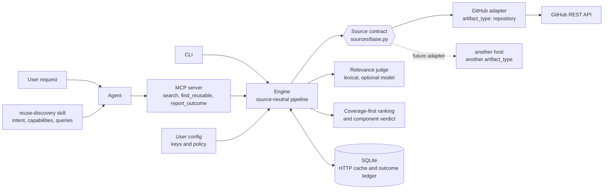
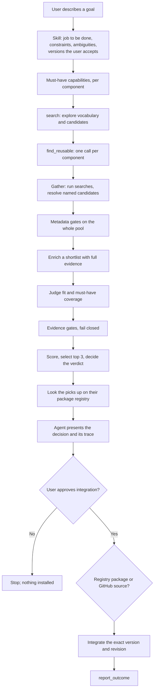

# Reuse Layer architecture

Reuse Layer helps an agent find and assess reusable open-source components before building them. The
agent works out what the user needs; the server verifies, gates and ranks what the agent proposes.

The server has two halves. The **engine** runs a pipeline that is the same for every source. A **source
adapter** holds everything specific to one host. GitHub is the only adapter in this release.

## System view

## Request flow

Each component gets its own `find_reusable` call and its own decision. Checks run one after another, so a
timeout or a retry belongs to one component.

## What the engine owns and what a source owns

| Step | Engine (`core/engine.py`) | Source (`sources/base.py`) |
| --- | --- | --- |
| Plan | chooses caller queries or the fallback | `clean_query`, `fallback_queries` |
| Gather | runs everything in parallel, pools and de-duplicates, records what failed | `search`, `resolve`, `parse_ref` |
| Metadata gates | drops candidates that fail, builds the shortlist | `metadata_gates` |
| Enrich | enforces the time budget, passes the caller's `ref_policy`, records what did not finish | `enrich` |
| Judge | lexical judge, optional model judge, agreement bonus | `card` |
| Evidence gates | turns unfinished checks into decisive gaps | `evidence_gates` |
| Score | track record from the ledger, weighted total, selection, verdict | `assess` |
| Package | bounds it in time, after the verdict; it cannot change the decision | `check_packages` |
| Respond | the shared result and pick fields | `pick_details`, `brief` |

The engine never names a host. Messages that do ("GitHub is not connected") come from the source through
`connection_note` and `rate_limit_note`.

## One result shape

Every pick has the same identity fields, whichever source produced it:

| Field | Meaning |
| --- | --- |
| `id` | `pkg:<provider>/<name>@<version>` |
| `provider`, `artifact_type` | the source's id and the kind of artifact |
| `name`, `url` | canonical name and location |
| `version`, `revision` | the pinned human-facing version and the immutable revision |
| `version_kind` | what the version is: `release`, `prerelease`, `tag` or `branch` |
| `license` | SPDX id as the host reports it; `null` when not established |
| `summary`, `why`, `scores`, `gates` | the evidence behind the pick |
| `unresolved_checks`, `integration_risks` | what stayed unknown, and what to watch |

A source adds its own fields on top with `pick_details`. GitHub adds `get`, `ref_freshness`, `owner_tier`,
`docs` and `package`: whether the language's registry publishes the pick at its pinned version, filled by
`check_packages` through `sources/packages.py`. That module reads the package's manifest at the pinned
commit through a small `RepoFiles` interface (the root listing, the file tree for monorepos, one file's
text), so another source can reuse it by implementing those three reads. It links a package to the
repository by the registry's metadata or by the build attestation the registry holds (`attested`), and
never verifies signatures itself. A source with nothing to look up makes `check_packages` a no-op. Unknown values stay unknown; an adapter must not fill a gap with a guess. Scores from
different sources are not calibrated against each other and must not be compared as if they were.

## Adding a source

`artifact_type` is the routing key: one adapter serves each type, and callers select it with the
`artifact_type` argument of `search` and `find_reusable`. There is no separate provider registry. The
allowed values of that argument are the registry, and an agent sees them in the tool schema.

1. Implement the `Source` protocol from `sources/base.py` in a new module under `sources/`.
   `sources/github.py` is the reference implementation.
2. Add the new type to `ArtifactType` in `core/models.py`.
3. Register the adapter in `build_sources` (`sources/__init__.py`).
4. Add a section for the artifact type to the `reuse-discovery` skill, under "What can be searched".
5. Add its key to `KNOWN_KEYS` in `config.py` if the host needs a credential.

An adapter describes candidates with the shared records in `core/models.py`: `Repo` for identity and
metadata, `DeepFacts` for fetched evidence. That is what lets the relevance judge, the ranking formula,
the verdict rules and the ledger work for it unchanged. Its gates and trust signals are its own: the
checks that matter for a repository (advisories, upstream CI, signed tags) are not the ones that matter
for a model or a dataset.

Two things are still shaped by having a single source, and should be revisited with the second one:

- The pipeline limits (`deadline_ms`, `max_candidates`, `deep_enrich`) live under `[github]` in the
  config file.
- The outcome ledger keys a pick by name alone. Two hosts that both have an `owner/name` would share a
  track record until the key includes the provider.
